# Rzeszów w pikselach

Izometryczna mapa pixel-art komunikacji miejskiej w Rzeszowie (WebGL 2, bez zależności)
oraz pipeline, który cyklicznie pobiera aktualny rozkład GTFS i przebudowuje stronę.
Budynki, woda, teren, drogi i tory pochodzą z OpenStreetMap.

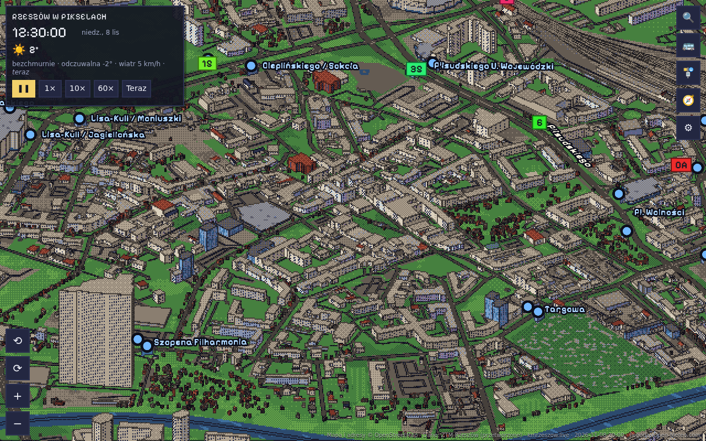

## Screeny
| | |
|---|---|
| 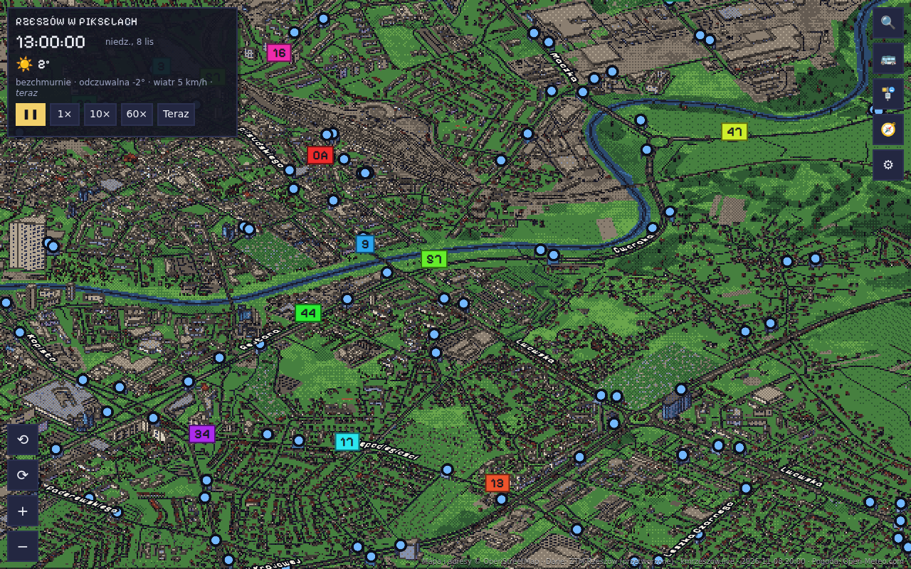 | 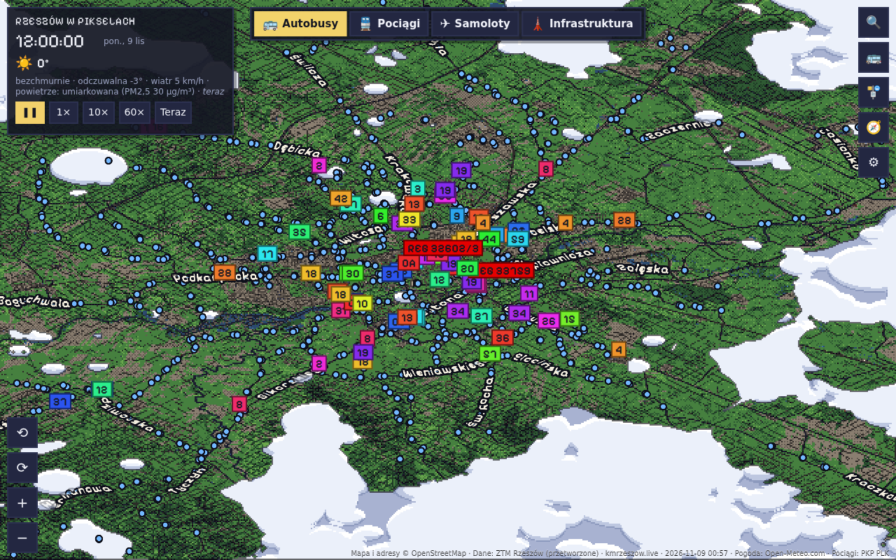 |
| **Wisłok:** rzeka, osiedla i hale | **Całość:** miasto, zalew i lasy w okolicy |
| 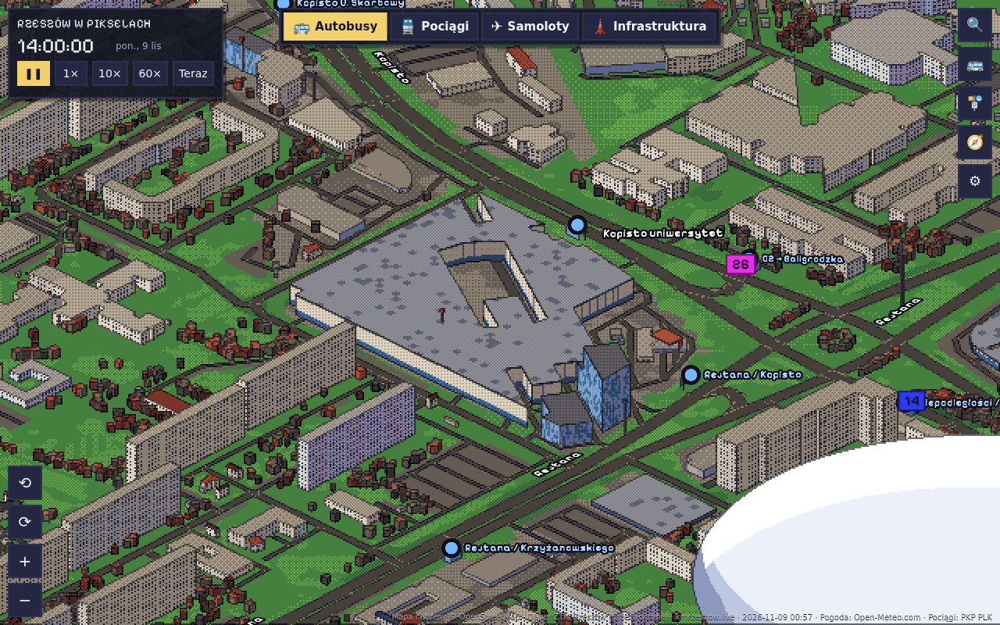 | 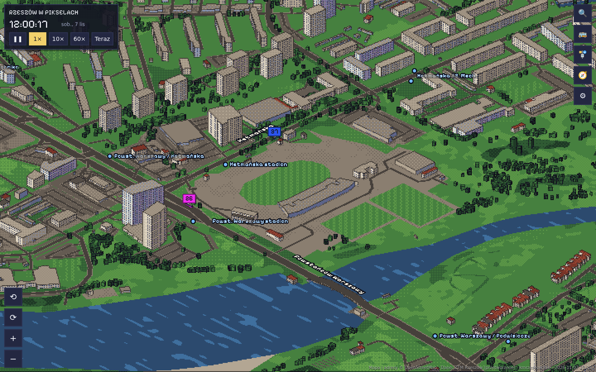 |
| **Galerie i biurowce:** przeszklony parter, szklane fasady | **Stadiony:** murawa, boiska, trybuny |
| 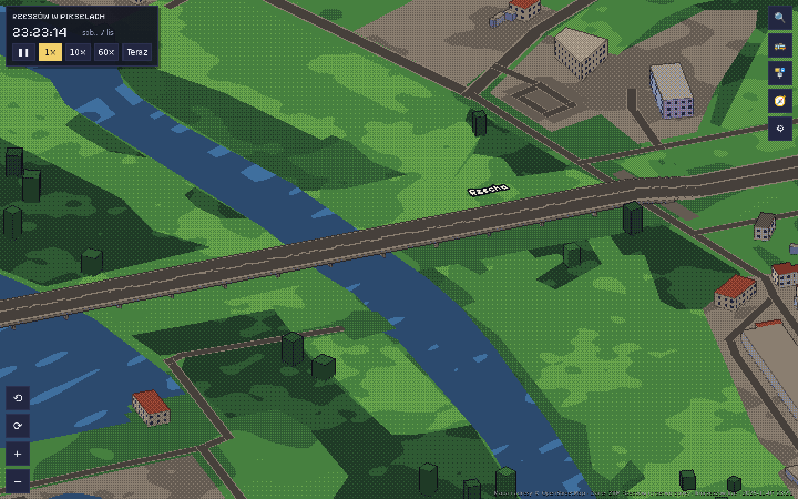 | |
| **Mosty:** pomost z podjazdami i filarami | |
| 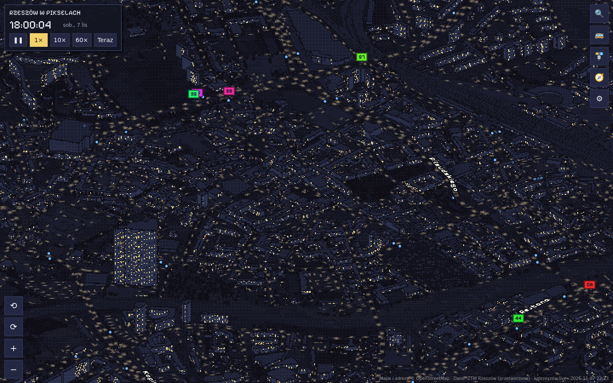 | 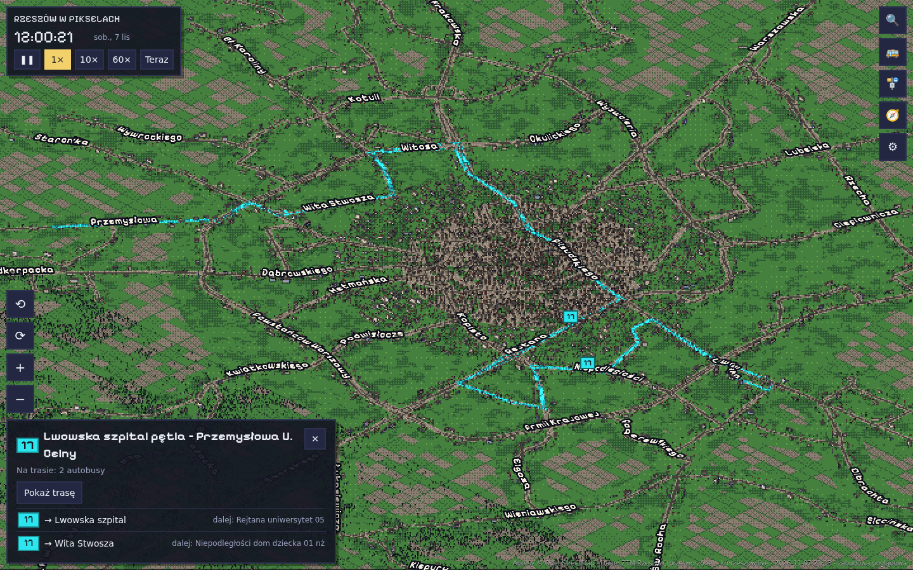 |
| **Noc:** światła w oknach i autobusy według rozkładu | **Linia:** trasa i autobusy wybranej linii |
| 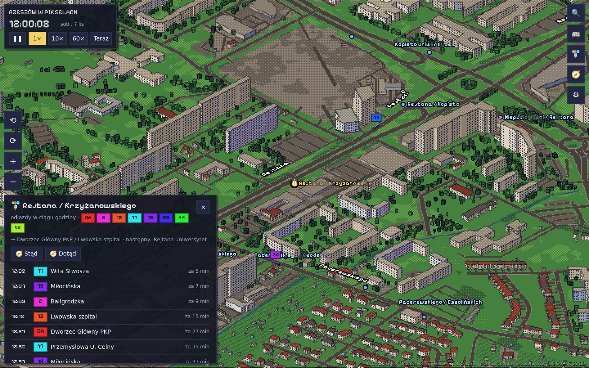 | 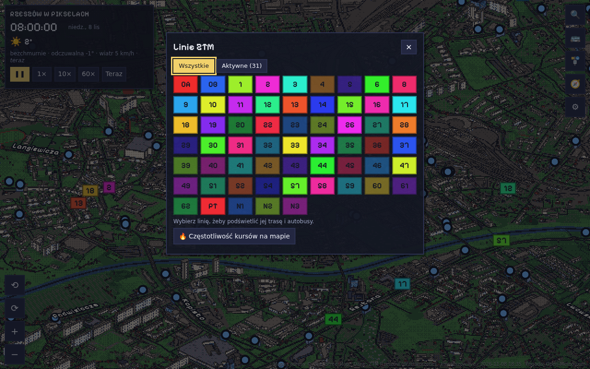 |
| **Przystanek:** tablica odjazdów | **Linie:** lista wszystkich linii ZTM |
| 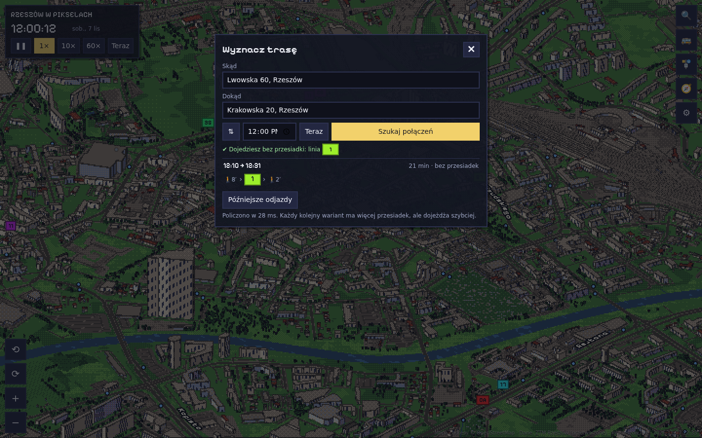 | 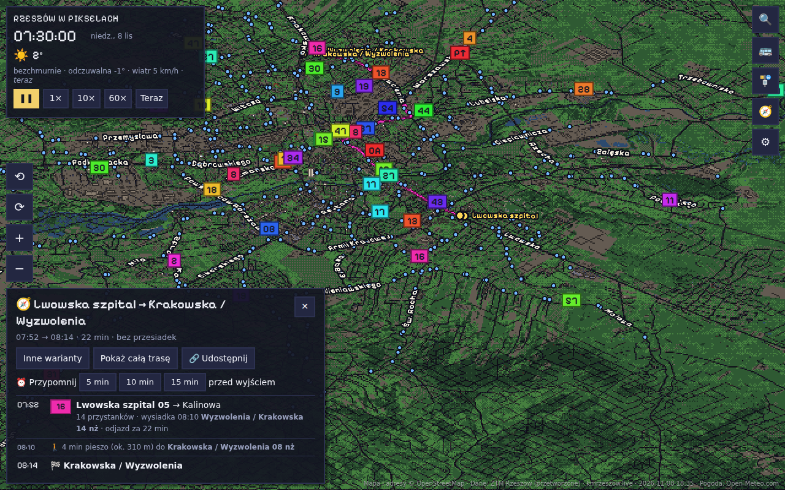 |
| **Planer:** połączenia od adresu do adresu | **Trasa:** wybrany wariant na mapie |

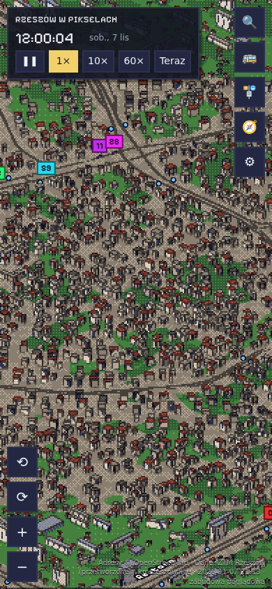

**Telefon:** ten sam widok na wąskim ekranie.

Screeny pokazują rozkład i dane OSM z 2026-11-08.

## Pliki
| Plik | Co robi |
|---|---|
| `pipeline.py` | pobiera GTFS, OSM i wysokości terenu, sprawdza zmiany, buduje i podmienia `dist/` |
| `run.sh` | wrapper dla crona (ustawia katalog roboczy i Pythona) |
| `pipeline.example.json` | przykładowa konfiguracja — skopiuj do `pipeline.json`, jeśli chcesz coś zmienić |
| `prep.py` | GTFS → kompaktowy `data.json` (rzutowanie, upraszczanie tras, wzorce kursów) |
| `osm.py` | warstwy OpenStreetMap → kompaktowa mapa (budynki, teren, woda, drogi, drzewa) |
| `dem.py` | siatka wysokości terenu z kafli Terrain Tiles (AWS Open Data) |
| `rail.py` | pociągi z ogólnopolskiego GTFS kolei, przycięte do obszaru mapy i dopisane do GTFS autobusów |
| `bts.py` | stacje bazowe telefonii z arkuszy UKE (xlsx czytane biblioteką standardową) |
| `diff.py` | porównanie dwóch wersji rozkładu → `dist/changes.json` |
| `build.py` | skleja moduły z `src/`, wkleja dane (gzip + base64), kopiuje manifest, service worker i ikony |
| `src/index.html` | szablon strony; dołącza `src/style.css` i moduły `src/js/*.js` (renderer, UI, planer, pogoda…) |
| `src/vendor/earcut.js` | [earcut](https://github.com/mapbox/earcut) (ISC) do triangulacji dachów i terenu |
| `src/static/` | manifest PWA, service worker, ikony (generuje je `tools/make_icons.py`) |
| `proxy.mjs` | serwer strony i proxy GTFS-Realtime → JSON (pozycje, prognozy, komunikaty; Node 18+, bez zależności) |
| `tests/` | testy jednostkowe (Python, Node) na sztucznej sieci, testy e2e w przeglądarce, skrypt screenów |
| `.github/` | CI: premerge, postmerge, release (opis niżej) |
| `docs/screenshots/` | screeny używane w tym README (odświeża je CI) |

Wymagania: Python 3.9+ (tylko biblioteka standardowa) i, do serwera i danych na żywo, Node 18+.
Testy e2e i screeny potrzebują `npm ci` (Playwright, axe-core).

## Szybki start
```sh
cd traffic.map
python3 pipeline.py -v          # pierwszy build → dist/index.html
```
`dist/index.html` to samodzielny plik: można go otworzyć w przeglądarce albo wrzucić na hosting.

## Cron (Linux / macOS)
Pipeline sprawdza zmiany, więc może chodzić często. Gdy nic się nie zmieniło, serwer odpowiada
`304` i nic się nie przebudowuje. Paczka kmrzeszow.live obejmuje tylko kilka dni do przodu,
dlatego uruchamiaj go co najmniej raz dziennie. Rozsądnie jest co godzinę:

```sh
crontab -e
```
```
17 * * * * /ścieżka/do/traffic.map/run.sh >> /ścieżka/do/traffic.map/work/cron.log 2>&1
```
Na standardowe wyjście trafiają tylko ostrzeżenia i błędy. Pełny log jest w `work/pipeline.log`
(rotacja 3 × 1 MB).

macOS: jeśli projekt leży w Dokumentach, na Biurku albo w Pobranych, nadaj `/usr/sbin/cron`
„Pełny dostęp do dysku” (Ustawienia → Prywatność i ochrona). Inaczej cron nie zobaczy plików.

## Windows (Harmonogram zadań)
```bat
schtasks /Create /SC HOURLY /MO 1 /TN "RzeszowWPikselach" /TR "py C:\ścieżka\traffic.map\pipeline.py"
```

## Jak działa pipeline
1. **Blokada.** Jeśli poprzednie uruchomienie jeszcze trwa, nowe kończy się od razu.
2. **Pobranie.** Źródła są pobierane po kolei, z nagłówkami `If-None-Match` / `If-Modified-Since`.
   Zapasowe źródło jest odpytywane tylko wtedy, gdy główne zawiedzie albo jego rozkład nie obejmuje dziś.
3. **Weryfikacja paczki.** Sprawdzana jest integralność ZIP, obecność wymaganych plików GTFS
   i zakres dat.
4. **Wykrywanie zmian.** Build rusza tylko wtedy, gdy zmieniła się paczka, dane OSM albo kod
   (`index.src.html`, `prep.py`, `osm.py`, `build.py`). `--force` wymusza build.
5. **Build i walidacja.** Wynik musi mieć minimalną liczbę linii, kursów i przystanków
   oraz niepusty kalendarz.
6. **Atomowa podmiana.** `dist/index.html` jest podmieniany jednym `rename`, więc nigdy nie ma
   wersji w połowie zapisanej. Przy każdym błędzie zostaje poprzednia, działająca strona.
7. **Archiwum.** Użyte paczki trafiają do `work/archive/` (domyślnie 14 ostatnich).
   `dist/build-info.json` opisuje, z czego zbudowano stronę.
8. **post_build** (opcjonalnie). Komenda po udanym buildzie, np. wysyłka na serwer:
   ```json
   "post_build": "rsync -az dist/ user@serwer:/var/www/rzeszow/"
   ```
   Dostępne zmienne: `RWP_INDEX`, `RWP_OUT_DIR`, `RWP_SOURCE`, `RWP_FEED_VERSION`.

Kody wyjścia: `0` zbudowano albo bez zmian · `1` żadne źródło nie działa ·
`2` build nie przeszedł walidacji · `3` błąd `post_build`.

Jeśli żadna paczka nie obejmuje dzisiejszej daty, publikowana jest najlepsza dostępna,
a strona sama przełącza się na rozkład wzorcowy (sobota, niedziela albo dzień roboczy)
i pokazuje to przy zegarze.

## Dane na żywo
```sh
FEED_URL="<Vehicle Positions .pb>" TRIP_UPDATES_URL="<Trip Updates .pb>" ALERTS_URL="<Alerts .pb>" node proxy.mjs
```
Adresy kanałów są na kmrzeszow.live/otwartedane. Każda zmienna jest opcjonalna, a bez żadnej serwer podaje samą stronę.
Otwórz http://localhost:8787/. Strona sama wykrywa `vehicles.json` obok siebie i włącza tryb na żywo
(adres wpisany w ⚙ Ustawienia ma pierwszeństwo). Serwer czyta pliki z `dist/` przy każdym żądaniu,
więc po przebudowie wystarczy odświeżyć stronę. Wysyła nagłówki bezpieczeństwa (CSP, nosniff, bez ramek).

- **Pozycje** (`/vehicles.json`): autobusy w miejscu z GPS, opóźnienie liczone z pozycji na trasie.
- **Prognozy** (`/trips.json`): opóźnienie dla każdego przystanku (`+4′` na tablicy), odwołane kursy.
- **Komunikaty** (`/alerts.json`): objazdy i utrudnienia na tablicy przystanku, przy linii i kursie;
  licznik „⚠ N komunikatów” w górnym panelu.

## Silnik w skrócie
1. Scena renderowana do małej tekstury (rozmiar piksela 1–4) z wyjściami: kolor, normalne, głębia.
2. Post-processing: kontury z laplasjanu głębi i różnic normalnych, dithering Bayera 4×4,
   kwantyzacja do 32-kolorowej palety, skalowanie metodą najbliższego sąsiada.
3. Kamera ortograficzna (30°, obrót co 90°) przyciągana do siatki pikseli, więc obraz nie migocze.
4. Prostokątne budynki (ok. 80%), drzewa i autobusy to jeden instancjonowany prostopadłościan.
   Pozostałe budynki to bryły wyciągnięte z obrysu OSM (triangulacja dachów: earcut).
   Okna i nocne światła powstają w shaderze, wspólnym dla obu rodzajów budynków.
5. Teren i woda to płaskie wielokąty rysowane w kolejności klas (woda na wierzchu).
   Drogi, tory i cieki to pasy z szerokością zależną od klasy i zoomu.
6. Świat jest podzielony na kafle 1,5 km. Rysowane są tylko kafle w kadrze. W kaflu budynki są
   posortowane od największych, więc przy oddaleniu rysowany jest tylko początek listy.

## Mapa z OpenStreetMap
`pipeline.py` pobiera z Overpass API cztery warstwy dla obszaru sieci (`map` w konfiguracji) i trzyma je
w `work/cache/osm-*.json.gz`. Odświeża je co 14 dni, a każdą warstwę osobno. Gdy pobranie się nie uda, warstwa
zostaje w poprzedniej kopii, a brakująca jest pobierana przy następnym uruchomieniu. `osm.py` zamienia je na
kompaktowy format wklejany do strony (ok. 3,6 MB po kompresji, strona ma ok. 6 MB).

| Warstwa | Co z niej powstaje |
|---|---|
| budynki | ok. 167 tys. brył. Prostokątne zapisywane jako obrócony prostopadłościan, pozostałe z pełnym obrysem i dziedzińcami. Galerie handlowe, biurowce, kościoły i trybuny mają własny wygląd; wieżowce i obiekty specjalne widać z każdej odległości |
| teren | lasy, łąki, pola, ogródki, cmentarze, tereny przemysłowe, parkingi, obiekty sportowe (murawa, bieżnie), woda (Wisłok, zalew, stawy) |
| drogi | od autostrad po drogi dojazdowe (te ostatnie tylko z bliska) oraz tory kolejowe. Mosty i wiadukty dłuższe niż 15 m są podniesione, z podjazdami i filarami; autobusy wjeżdżają na pomost |
| drzewa | pojedyncze drzewa (`natural=tree`) w dokładnych pozycjach |

Bez danych OSM (np. `"map": {"enabled": false}`) strona wraca do zabudowy poglądowej, generowanej wzdłuż tras.

## Podpisy i szukajka
- **Ulice:** nazwy pochodzą z kolumny `street_name` w `stops.txt`. Odcinek trasy między dwoma
  kolejnymi przystankami na tej samej ulicy dostaje jej nazwę (`streets` w `data.json`).
  Napis to płaski mesh 3D z glifów ułożonych wzdłuż ulicy, zawieszony 22 m nad nią.
  Proporcje liter są korygowane o skrót perspektywy, a napis zawsze czyta się z lewej do prawej.
  Za budynkiem napis się przyciemnia. Rozmieszczenie unika kolizji i jest przeliczane przy zmianie zoomu i obrocie.
- **Przystanki:** przy każdym słupku stoi wiata (dach, szklana ściana, żółto-zielony znak), z daleka powiększona,
  a na jej dachu duża kropka, widoczna i klikalna przy każdym zoomie. Jeden podpis na grupę słupków o tej samej nazwie, zawsze w pełni widoczny, także za budynkiem.
  Tablica odjazdów łączy wszystkie słupki grupy.
  Odjazdy autobusów, które już jadą w stronę przystanku, są wyróżnione (ile przystanków stąd); filtr „W drodze” pokazuje tylko je.
- **Zaznaczony autobus lub linia:** jego przystanki są wyróżnione i podpisane przy każdym zoomie, pozostałe przygaszone.
  Podpis przystanku klika się tak samo jak kropka. Z daleka kropki są mniejsze, żeby nie zasłaniały mapy.
- **Szukajka** (🔍 albo `/`): linie po numerze lub nazwie trasy, przystanki po nazwie,
  bez względu na polskie znaki.

## Lista przystanków i planer połączeń
- **🚌** to lista linii z filtrem „Wszystkie / Aktywne” (aktywne: z autobusem teraz na trasie).
- **🚏** to alfabetyczna lista przystanków z filtrem i liniami, które się na nich zatrzymują.
- **🧭** (albo klawisz `P`, albo „Stąd” / „Dotąd” na tablicy przystanku) wyznacza połączenie
  algorytmem RAPTOR (Round-based Public Transit Routing). Liczy najszybszy dojazd bezpośrednio,
  z 1, 2 i 3 przesiadkami. Pokazuje tylko warianty, w których dodatkowa przesiadka daje szybszy dojazd.
  Uwzględnia przejścia piesze do 400 m (1,2 m/s, współczynnik krętości 1,25),
  minimum 60 s na przesiadkę i okno 4 h od wybranej godziny. Jedno wyszukiwanie trwa kilka ms w przeglądarce.
- Warianty są posortowane od najkrótszego czasu podróży, a pierwszy od razu trafia na mapę. „Poprzedni wariant”
  wraca do trasy pokazanej wcześniej, także sprzed „Późniejszych odjazdów”.
- Wybrany wariant jest rysowany na mapie: przejazdy w kolorach linii, przejścia piesze przerywaną
  linią, przystanki wsiadania i wysiadania podświetlone. Autobusy z wariantu są wyróżnione.

## Wyszukiwanie od adresu, strony ruchu, lokalizacja
- **Start i cel** mogą być: adresem („Rejtana 16”, „al. Piłsudskiego 34”, „Tyczyn 7, Tyczyn”),
  całą ulicą („Sikorskiego”, czyli dowolne miejsce na niej), przystankiem, Twoją lokalizacją albo punktem wskazanym
  na mapie. Planer dolicza dojście pieszo do przystanków w promieniu 1 km i pokazuje wariant pieszy
  do 2,5 km. Kolejne przejścia piesze są łączone w jedno.
- **Adresy z numerami** pochodzą z OpenStreetMap (ODbL). `pipeline.py` pobiera je z Overpass API
  (`addresses` w konfiguracji), trzyma kopię w `work/cache/addresses.json` i odświeża co 14 dni.
  Gdy pobranie się nie uda, używa poprzedniej kopii. Do strony trafiają adresy w promieniu 1,5 km
  od przystanków. Bez bazy adresów wyszukiwanie działa po nazwach ulic z danych przystanków.
- **Strony ruchu:** każdy słupek ma opis kierunku. Pokazywane są tylko kierunki odróżniające go od
  słupka po drugiej stronie, a gdy ich brak, następny przystanek. Tablica ma przełącznik stron, listy
  pokazują słupki pod nazwą przystanku, a z bliska mapa podpisuje każdy słupek osobno.
- **Moja lokalizacja** wymaga strony otwartej z `localhost` albo przez https. W podglądzie w Claude
  przeglądarka ją blokuje, wtedy działa „Wskaż na mapie”.

## Linki, rozkład, przypomnienia
- **Linki do widoku:** adres strony nadąża za tym, co widać (kamera, przystanek, linia, kurs, trasa z planera, godzina),
  np. `#s=Rejtana / Kopisto`, `#l=17`, `#from=s:Lwowska szpital&to=p:50.03,22.01,Dom&at=07:30`. Przystanki i linie są
  zapisane nazwami, więc link działa też po przebudowie rozkładu. „🔗 Udostępnij” kopiuje link albo otwiera systemowe udostępnianie.
- **📅 Rozkład** na tablicy przystanku: godziny i minuty odjazdów każdej linii i kierunku, na dziś, dzień roboczy, sobotę albo niedzielę.
- **⏰ Przypomnij** w planerze: powiadomienie 5, 10 albo 15 min przed wyjściem. Czas wyjścia przesuwa się razem z opóźnieniem
  pierwszego autobusu. Strona musi być otwarta.
- **📰 Zmiany w rozkładzie:** po nowej wersji paczki pipeline porównuje ją z poprzednią (`diff.py`: liczba kursów w typach dni,
  takt w szczycie, pierwszy i ostatni kurs, przystanki linii). Strona pokazuje wynik, dopóki go nie obejrzysz.

## Tryby: autobusy, pociągi, samoloty, infrastruktura
Zakładki u góry ekranu (na telefonie na dole, klawisze 1–4) przełączają **interfejs**: każdy tryb ma własne narzędzia
po prawej, listy, szukajkę i planer. Mapa przez cały czas rysuje wszystko naraz. Kliknięcie pociągu, samolotu czy
stacji bazowej na mapie samo przełącza tryb. Tryb trafia do linku (`mode=rail`).

| Tryb | Narzędzia |
|---|---|
| 🚌 Autobusy | szukaj linii i przystanków, linie ZTM, przystanki, planer (same autobusy), częstotliwość |
| 🚆 Pociągi | szukaj pociągu po numerze lub nazwie i stacji, pociągi teraz w okolicy, stacje, planer autobus + pociąg |
| ✈ Samoloty | samoloty w zasięgu (od najbliższych), lotnisko Jasionka: podejścia, starty, płyta, dojazd pociągiem i autobusem |
| 🗼 Infrastruktura | listy: stacje bazowe (filtr operatora), stacje paliw, ładowarki, maszty, statystyki sieci energetycznej |

Co widać na mapie, ustawia się osobno: Ustawienia → „Na mapie” (warstwy, w linku `m=brai`). Kropki i podpisy
przystanków należą do trybu: autobusowe w autobusach, stacje w pociągach, w samolotach jest punkt lotniska Jasionka
(kliknięcie otwiera ruch na lotnisku). W trybie infrastruktury pasek pod zakładkami wybiera sekcje rysowane na mapie
(energetyka, stacje bazowe, paliwo, ładowarki, maszty).

**Chmury:** pola i lasy daleko od komunikacji oraz wszystko za krawędzią danych zakrywa animowany bank pixel-artowych
chmur (kłęby z jasną krawędzią, cieniem i obrysem, dryfujące z wiatrem); front ma zatoki i jęzory, miasto zostaje
odkryte. Nad miastem pływa kilka cumulusów, więcej przy pochmurnej pogodzie. Pomysł za
[mapą Krakowa](https://michalpietralik.pl/cracowpixelmap/). Do wyłączenia w ustawieniach.
- **🚆 Pociągi** (`rail.py`): rozkład wszystkich pociągów w Polsce ([mkuran.pl/gtfs](https://mkuran.pl/gtfs/), dane PKP PLK)
  przycięty do obszaru mapy: kursy IC i PolRegio między 33 stacjami (Rzeszów Główny, Zachodni, Staroniwa, Jasionka Lotnisko…).
  Pociągi są dopisywane do GTFS autobusów, więc tablice odjazdów stacji, rozkład i planer połączeń (autobus + pociąg)
  działają tak samo. Na mapie składy wagonów jadą po torach, stacje mają peron z wiatą.
- **✈ Samoloty**: pozycje ADS-B z [adsb.lol](https://adsb.lol/) (ODbL) w promieniu ok. 75 km, przez `proxy.mjs`
  (`/aircraft.json`, co 8 s, tylko gdy strona pyta). Wysokość lotu jest ściśnięta, cień pokazuje miejsce nad ziemią.
  Kliknięcie: lot, typ, rejestracja, wysokość, prędkość. Lotnisko Jasionka (pas, drogi kołowania, płyta) jest z OSM.
  Bez proxy (np. GitHub Pages) samolotów nie ma.
- **🗼 Infrastruktura**: linie energetyczne ze słupami i stacje transformatorowe, maszty i wieże (OSM), stacje bazowe telefonii
  z [wykazu pozwoleń radiowych UKE](https://bip.uke.gov.pl/pozwolenia-radiowe/) (operatorzy, systemy 2G–5G i pasma, `bts.py`),
  stacje paliw z marką i LPG/CNG oraz ładowarki EV ze złączami i mocą (OSM). Cen paliw nie ma w otwartych danych.

## Mapa: pogoda, pory roku, teren, częstotliwość
- **Pogoda** z [Open-Meteo](https://open-meteo.com/) (bez klucza): w panelu w lewym górnym rogu temperatura, opis, odczuwalna,
  wiatr, pokrywa śnieżna i jakość powietrza (indeks EAQI i PM2,5 z modelu CAMS). Na mapie deszcz, śnieg i mgła,
  mokry asfalt, zachmurzenie przyciemnia słońce, a przy złym powietrzu miasto spowija smog.
  Wschód i zachód słońca są z prognozy. Efekty działają, gdy symulacja jest blisko teraz (±3 h).
- **Pory roku** z daty symulacji: liście przebarwiają się od połowy września, zimą trawa jest sucha, a śnieg leży według
  grubości pokrywy z prognozy. W ustawieniach można wymusić porę roku albo wyłączyć pogodę.
- **Rzeźba terenu:** siatka wysokości co 150 m z kafli [Terrain Tiles](https://registry.opendata.aws/terrain-tiles/)
  (AWS Open Data, format Terrarium, kilkanaście kafli PNG na obszar sieci), pobierana raz i trzymana w `work/cache/dem.json.gz`. Wysokość dodają shadery, więc ten sam plik danych działa też płasko
  (ustawienie „Rzeźba terenu”: wł., ×2, płasko).
- **Dachy dwuspadowe** na niskich, prostokątnych domach jednorodzinnych.
- **🔥 Częstotliwość** (lista linii albo `H`): trasy w kolorze liczby odjazdów na godzinę o tej porze.
- **⏱ Zasięg** na tablicy przystanku: dokąd dojedziesz w 10, 20, 30 i 45 min (RAPTOR bez celu, z przesiadkami i dojściem pieszo).
- **Automatyczna jakość:** przy mniej niż ok. 24 kl./s strona rysuje mniej szczegółów, potem większy piksel; wraca, gdy jest zapas.

## Telefon i dostępność
- **PWA:** strona otwarta przez http(s) da się zainstalować na ekranie telefonu i działa offline (ostatnio pobrany rozkład).
  Service worker ma wersję ze skrótu strony, więc nowy build to od razu nowy cache.
- **Klawiatura i czytniki ekranu:** wiersze list, numery linii i podpowiedzi to przyciski (Tab, Enter, spacja), okna są
  dialogami z etykietami (fokus w środku, Escape zamyka, fokus wraca). Skróty: `/` szukaj, `L` linie, `P` planer, `H` częstotliwość,
  `Q`/`E` obrót, strzałki lub WASD przesuwanie, spacja pauza. CI sprawdza stronę narzędziem axe-core.

## Testy i CI
```sh
npm test            # testy jednostkowe: Python (prep, build, diff, dem, notatki) i Node (RAPTOR, linki, rozkład, proxy, pogoda…)
npm ci && npx playwright install chromium
npm run e2e         # przeglądarka na sieci testowej: ładowanie, szukajka, linki, planer, dane na żywo, PWA offline, a11y
npm run screenshots # screeny do README z dist/index.html (po pipeline.py)
```
Testy działają na małej, sztucznej sieci z `tests/fixture.py`, bez pobierania danych.

| Workflow | Kiedy | Co robi |
|---|---|---|
| `premerge` | PR i push na gałąź inną niż `main` | ruff, składnia JS, actionlint, testy (Python 3.9 i 3.12, Node), e2e, SAST (CodeQL, Semgrep), SCA (dependency review, OSV-Scanner), sekrety (gitleaks) |
| `postmerge` | merge do `main` (zmiany w kodzie), ręcznie | DAST (OWASP ZAP na `proxy.mjs`), pełny pipeline na prawdziwych danych, nowe screeny jako PR |
| `release` | zamknięcie milestone'a `vX.Y.Z` albo ręcznie | tag, notatki z PR-ów milestone'a pogrupowane etykietami, `index.html` i paczka zip jako załączniki, deploy strony na GitHub Pages |
| `data-sync` | codziennie, ręcznie | nowy rozkład ZTM → wydanie z poprawką i deploy na Pages; bez zmian nic nie robi |

**Wydania:** przypisz PR-y do milestone'a nazwanego jak wersja (np. `v1.2.0`) i zamknij go. Etykiety PR-ów
(`feature`, `bug`, `security`, `docs`, `ci`) wyznaczają sekcje notatek, a `skip-changelog` pomija PR.
Postmerge otwiera PR ze screenami; w ustawieniach repozytorium trzeba pozwolić Actions tworzyć PR-y
(Settings → Actions → General → „Allow GitHub Actions to create and approve pull requests”).

**GitHub Pages:** każde wydanie (poza szkicem) publikuje stronę na Pages; raz trzeba ustawić
Settings → Pages → Source: „GitHub Actions”. Pages to hosting statyczny bez `proxy.mjs`, więc strona pokazuje
autobusy według rozkładu, bez pozycji na żywo.

**Synchronizacja rozkładu** (`data-sync`, codziennie): pipeline pobiera paczki GTFS i, jeśli ZTM opublikował nowy rozkład,
tworzy wydanie z poprawką (np. `v1.2.0` → `v1.2.1`) z notatkami o zmienionych liniach i wdraża stronę na Pages.
Strona jest budowana z kodu ostatniego wydania, więc niewydany kod z `main` nie trafia na Pages. Bez PR-ów:
paczki GTFS nie są w repozytorium. Kolejny milestone nazwij więc wersją wyższą niż ostatnie wydanie.

## Ograniczenia
- **Rzeźba terenu** ma rozdzielczość ok. 90 m (model DEM), więc skarpy i nasypy są wygładzone. Budynki stoją na wysokości
  terenu w punkcie środkowym, a budynki o złożonym obrysie dopasowują się w każdym narożniku.
- **Wysokości budynków** pochodzą z OSM tylko dla ok. 21% budynków (`height`, `building:levels`).
  Pozostałe są szacowane z typu i powierzchni. Dachy dwuspadowe dostają tylko niskie, prostokątne domy jednorodzinne
  (OSM rzadko podaje `roof:shape`), pozostałe dachy są płaskie.
- **Drzewa w lasach** są rozmieszczane w granicach lasów z OSM, nie według rzeczywistych pozycji.
  Rzeczywiste pozycje mają tylko drzewa oznaczone w OSM pojedynczo.
- Mapa obejmuje prostokąt sieci ZTM (`bbox`). Poza nim jest tylko trawa.
- Paczka mkuran.pl (zapas) nie ma brygad, pełnych nazw linii ani nazw ulic (będą tylko podpisy przystanków).
- Podpisujemy tylko ulice, którymi jeżdżą autobusy i na których są co najmniej dwa kolejne przystanki.

## Licencja
Kod: [MIT](LICENSE). Repozytorium nie zawiera danych. Zbudowana strona (`dist/`) zawiera dane na licencjach poniżej:
przy jej publikowaniu trzeba zachować podpisy źródeł (strona pokazuje je w stopce i w ustawieniach).
Czcionka Pixelify Sans (SIL OFL) ładuje się z Google Fonts, earcut jest na licencji ISC.

## Dane
Mapa i adresy: © współtwórcy OpenStreetMap, licencja ODbL — https://www.openstreetmap.org/copyright.
Zbudowana strona zawiera bazę danych pochodną od OSM; jej udostępnianie podlega ODbL (podanie źródła, ta sama licencja dla bazy).

Pogoda i jakość powietrza: [Open-Meteo.com](https://open-meteo.com/), CC BY 4.0 (jakość powietrza: model CAMS, Copernicus).
Pociągi: PKP Polskie Linie Kolejowe S.A. ([otwarte dane](https://www.plk-sa.pl/klienci-i-kontrahenci/api-otwarte-dane)),
GTFS w opracowaniu [mkuran.pl](https://mkuran.pl/gtfs/). Samoloty: [adsb.lol](https://adsb.lol/), ODbL.
Stacje bazowe: Urząd Komunikacji Elektronicznej, wykaz pozwoleń radiowych.
Wysokości terenu: [Terrain Tiles](https://github.com/tilezen/joerd/blob/master/docs/attribution.md) (Mapzen, AWS Open Data).
W Polsce źródłem jest głównie EU-DEM („Produced using Copernicus data and information funded by the European Union — EU-DEM layers”)
oraz SRTM (NASA).

Rozkład: ZTM Rzeszów — https://otwartedane.erzeszow.pl/dataset/rozklady-jazdy-gtfs,
w opracowaniu kmrzeszow.live (zapasowo: mkuran.pl). Dane zostały przetworzone.
Gmina Miasto Rzeszów nie ponosi odpowiedzialności za dostępność, poprawność, aktualność,
kompletność i jakość przetworzonych danych. Przed publicznym udostępnieniem sprawdź warunki
serwisu kmrzeszow.live (hello@kmrzeszow.live).
